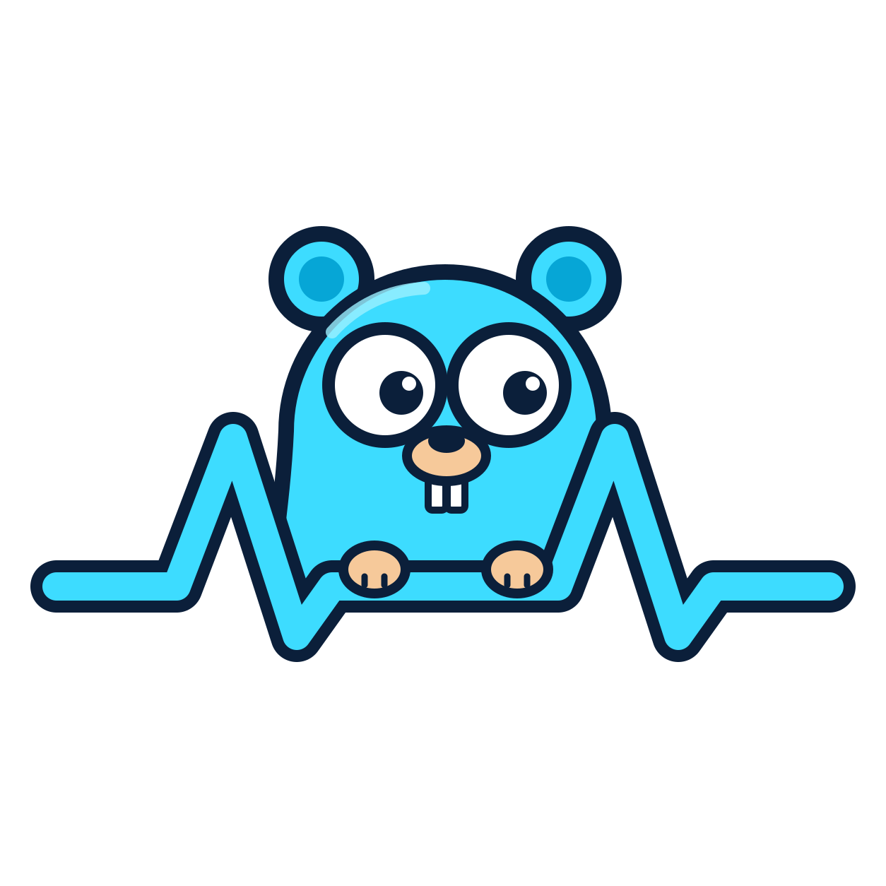

# beat

<p align="center"></p>

[](https://pkg.go.dev/github.com/uchaloop/beat) [](https://github.com/uchaloop/beat/actions/workflows/ci.yml) [](https://github.com/uchaloop/beat/tags) [](LICENSE)

**Run one job attempt or schedule recurring work in a long-lived Go process.**
The Runner owns execution, middleware and timeouts. The scheduler owns timing
and shutdown. Both use the same job result; neither requires Fx or reads ENV.

For example, use them for PostgreSQL queue processing, analytics exports or
periodic data synchronization. These are examples, not a restriction on use cases.

[Install](#installation) · [Choose a package](#quick-start) · [Reference](#reference)

## Installation

Requires Go 1.27.0 or later. This guide describes v0.8.0, which includes the
job and assignment packages in the beat module.

```sh
go get github.com/uchaloop/beat@v0.8.0
```

## Quick start

| Need | Package | Guide |
|---|---|---|
| One attempt, including a Kubernetes Job / CronJob | `github.com/uchaloop/beat/job` | [One-shot execution](docs/job/README.md) |
| Repeated attempts within one process | `github.com/uchaloop/beat` | [Scheduler](docs/beat/README.md) |
| Select the cluster owning a scheduled point | `github.com/uchaloop/beat/assignment` | [Assignment contract](assignment/assignment.go) |

Kubernetes or another launcher supplies an external schedule for a one-shot job.
Beat supplies an in-process fixed-rate or fixed-delay schedule. It has no calendar
expressions, persistent schedule, replay queue or distributed lock.

The guides include runnable starts, diagrams, configuration and observation.
Queue claiming, transactions, checkpoints and idempotency belong to the application.

The standalone `github.com/uchaloop/job` and `github.com/uchaloop/jobfx` modules
are being retired in favor of beat and beatfx. The names job and jobfx remain
subpackage names; they do not denote additional supported modules.

## Reference

- [Go API](https://pkg.go.dev/github.com/uchaloop/beat)
- [Scheduler examples](example_test.go) and [job examples](job/error_handler_example_test.go)
- [CHANGELOG](CHANGELOG.md)
- [beatfx](https://github.com/uchaloop/beatfx): optional Fx integration. Support for
  this package layout will follow the beat release; older adapters use standalone job types.

## License

[MIT](LICENSE)
