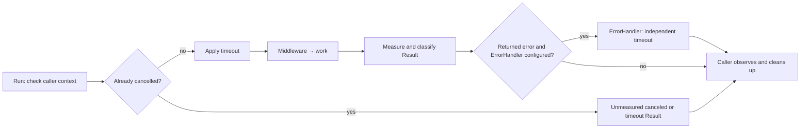

# job

**Execute one bounded attempt and return its result.**

[Overview](../../README.md) · [Install](#installation) · [Quick start](#quick-start) · [How it works](#how-it-works) · [Configuration](#configuration) · [Reference](#reference)

One attempt at a piece of work, and nothing about when the next one happens.

A short-lived process started by a Kubernetes CronJob runs one attempt and
exits. [beat](https://github.com/uchaloop/beat) runs the same work repeatedly
inside a long-lived process. Both drive the same `Runner`, so the work, its
middleware, its timeout and its classification are written once.

- **One attempt per call** - no retry, no goroutine of its own, no automatic observability Handler call.
- **A cooperative timeout** - it cancels the attempt's context and says so even
  when the work stayed quiet about it.
- **No dependencies** beyond the standard library and `uchaloop/validate`.

## Installation

Requires Go 1.27.0 or later. See the [installation and release status](../../README.md#installation). This package is included in the beat module.

```bash
go get github.com/uchaloop/beat
```

## Quick start

```go
package main

import (
    "context"
    "fmt"
    "os"
    "time"

    "github.com/uchaloop/beat/job"
)

func run() error {
    runner, err := job.MakeRunner(
        job.Config{Timeout: 3 * time.Minute},
        func(ctx context.Context) (int64, error) {
            // Replace with one batch of application work.
            return 0, ctx.Err()
        },
    )
    if err != nil {
        return err
    }
    result := runner.Run(context.Background())
    if result.Outcome != job.OutcomeOK {
        return fmt.Errorf("attempt outcome %s: %v", result.Outcome, result.Err)
    }
    fmt.Printf("processed: %d\n", result.Processed)
    return nil
}

func main() {
    if err := run(); err != nil {
        fmt.Fprintln(os.Stderr, err)
        os.Exit(1)
    }
}
```

Save as `main.go` in an application module using this version of beat and run
`GOWORK=off go run .`. Expected stdout: `processed: 0`, exit code 0.

## How it works



## The contract

`Run` calls the chain at most once, synchronously, and waits for it to return.
A caller's context that is already done skips the work entirely and reports why,
measuring nothing. A nil context returns `ErrContextIsNil` with `OutcomeError`;
a nil or zero Runner returns `ErrRunnerIsInvalid`. Neither invokes work or callbacks.
Create runners with `MakeRunner`; middleware returning nil is rejected with
`ErrMiddlewareFuncIsNil`. Middleware and handler input slices are copied, while
the referenced functions and handler instances remain shared.

| Field | Meaning |
|---|---|
| `StartedAt`, `Duration` | Start time and total duration, including optional ErrorHandler |
| `WorkDuration`, `ErrorHandlerDuration` | Time spent in each stage |
| `IsErrorHandlerCalled` | Whether error processing ran, even if its duration is zero |
| `ErrorHandlerErr` | Callback error and/or expired callback context, separate from the work error |
| `Processed` | What the work reported, kept even when it then failed |
| `Err` | The chain's error, which stays nil when a timeout cut a quiet Func short |
| `Outcome` | `ok`, `error`, `panic`, `timeout` or `canceled` - authoritative |

`Func` returns an `int64` count, stored unchanged in `Result.Processed`, including
partial progress on error. Return zero or more; the runner does not validate or
clamp the count. For slice lengths, use `int64(len(items))`.

> [!IMPORTANT]
> A timeout cancels the context; it cannot interrupt the function.
 Work must return when its context is done and
must wait for its own goroutines first. Work that ignores cancellation holds its
caller for as long as it likes, and no result is reported until it returns.

Outcome, not `Err`, decides whether an attempt succeeded. Classification uses
this precedence after the chain returns:

| Outcome | Condition |
|---|---|
| `panic` | Error contains a recovered `*job.PanicError` |
| `timeout` | Attempt context deadline expired, including an earlier caller deadline |
| `canceled` | Attempt context was cancelled |
| `error` | Chain returned another non-nil error |
| `ok` | None of the above |

A deadline can therefore produce `timeout` even when `Err` is nil.

## Configuration

| Field | Default env name | Default |
|---|---|---|
| `Timeout` | `JOB_TIMEOUT` | `1m` |
| `ErrorHandlerTimeout` | `JOB_ERROR_HANDLER_TIMEOUT` | `1m` |

`job.MakeRunner` accepts ordinary Go values and never reads the environment.
These env names apply to confmaker with instance name `job`, as shown below.
Zero durations select the defaults; negative durations are rejected.

## Error handling

In the following fragment, `work` is your job.Func and `failures.Store` is an
application method accepting context.Context and error and returning error.
Handle the constructor error before using runner.


An optional callback can log an error or persist application-defined data in a
DLQ. The library does not define the message format or retry delivery.

```go
runner, err := job.MakeRunner(
    job.Config{Timeout: time.Minute, ErrorHandlerTimeout: 15 * time.Second},
    work,
    job.WithErrorHandler(func(ctx context.Context, err error) error {
        return failures.Store(ctx, err) // Application-owned storage and error model.
    }),
)
```

The callback runs synchronously once, only for a non-nil error returned by the
work or middleware. It gets caller context values and a fresh deadline, without
inheriting cancellation. A work timeout returning nil does not call it; work
skipped because the caller was already cancelled does not call it either.

> [!IMPORTANT]
> Error processing has its own budget, even during shutdown. Allow time for both
> stages before closing dependencies. Neither context can force code to return.

`Err` and `Outcome` retain the original work result. `ErrorHandlerErr` reports
callback failure, joining its returned error with context expiration. Successful
DLQ delivery does not turn failed work into success. `Duration` includes both
stages, so schedulers account for error processing too. Persistence and source
acknowledgement remain application responsibilities; this callback alone does
not guarantee delivery. Recovery middleware does not cover callback panics.

## Middleware and observation

`WithMiddleware` composes wrappers once when MakeRunner is called. The first
wrapper is outermost. Repeated calls append middleware; nil entries are skipped.
`WithErrorHandler` is a setter: the last value wins and nil disables it.

| Tool | Responsibility |
|---|---|
| `ErrorHandler` | Handle a non-nil work error with an independent budget |
| `job.Handler` | Observe a Result when called by the execution owner |
| `job.MakeMultiHandler` | Deliver sequentially to multiple observers |
| `beat.Handler` | Observe a richer scheduler Record |
| Recovery middleware | Convert a panic inside the work chain into PanicError |

Runner does not call job.Handler. A manual caller may deliver the returned Result
once using `handler.Handle(ctx, result)` with an application-owned observation
budget. A scheduler calls its beat.Handler instead, avoiding implicit duplicate
observation. MakeMultiHandler copies the input slice, but observer instances
remain shared and must support concurrent calls if the caller uses them that way.

The [analytics export example](../../job/analytics_example_test.go) shows work failure,
ErrorHandler and result observation without external services. A real exporter
owns its destination, checkpoint and safe failure record. ErrorHandler is not an
automatic retry and does not define a delivery guarantee.

## Panics

They propagate by default. To turn one into a `*job.PanicError` on the result
instead, import `github.com/uchaloop/beat/job/middleware/recovery`.
Pass this option to MakeRunner, with `logger` supplied by the application:

```go
job.WithMiddleware(recovery.MakeMiddleware(recovery.WithLogger(logger)))
```

It protects only the wrapped work - not a handler, not goroutines the work
started. Error text and optional recovery logging omit the panic value and stack.
`PanicError.Value` and `Stack` remain available for explicit inspection and may
contain secrets; sanitize them before logging or serialization.

## Deployment configuration

[`assignment`](../../assignment/assignment.go) is an optional, pure policy for a deployment that runs in
several clusters: one cluster owns each scheduled point, and all of its replicas
run it.

Import `github.com/uchaloop/beat/assignment`. The following fragment belongs
in a function returning error; `point` is the original scheduled invocation.

```go
rotation, err := assignment.MakeRotation(assignment.Config{
    Clusters: []string{"el", "xc", "dm"},
    Current:  "el",
    Period:   4 * time.Hour,
})
if err != nil {
    return err
}

decision, err := rotation.Decide(assignment.Invocation{ScheduledAt: point})
if err != nil {
    return err
}
// Call Runner.Run only when decision.IsExecutable is true.
```

It reads no clock and keeps no state, so every process computes the same answer
from the same configuration - nothing is coordinated at run time. It decides who
should try, not that anyone did: a cluster that is down leaves its points
unserved, and no other cluster takes over. Work must survive a skipped attempt.

The caller passes the **scheduled point**, never the current time, so a pod that
starts late and a retry of the same scheduled Job decide as the original point
did.

`Decision.Slot` is a non-negative `uint64`. Scheduled points must be on the
epoch-anchored grid, from the Unix epoch through epoch + `MaxInt64` nanoseconds.
`OwnedAfter(after, count)` counts this cluster's slots among the `count` positions
following `after`, excluding `after` itself. It returns `uint64` and never adds
the two arguments, so counting remains safe even when their sum exceeds `MaxUint64`.

Changing the cluster list or period can produce duplicates or gaps while old
and new configurations coexist. Stop scheduling across all clusters and wait for
old attempts to finish, update the configuration everywhere, then resume; accept
the pause. A rolling restart is not sufficient. There is no
configuration agreement protocol or automatic failover.

## Optional Fx integration

The optional [beatfx](https://github.com/uchaloop/beatfx) module provides one-shot
execution through its `github.com/uchaloop/beatfx/jobfx` package. The beat module has no Fx dependency.

The adapter migration follows the beat release. Older adapter releases expect
standalone job types and cannot consume the new Runner. Core execution needs no Fx.

## Recommended configuration

> [!TIP]
> We recommend [confmaker](https://github.com/uchaloop/confmaker) for typed ENV
> configuration and [confx](https://github.com/uchaloop/confx) for its Fx integration.
> Configuration loading stays in the application; it is optional for the work libraries.

<details>
<summary><strong>Configure from ENV with confmaker / confx</strong></summary>

In an application function returning error, load the config before MakeRunner:

```go
cfg, err := confmaker.Load[job.Config]("job")
if err != nil {
    return err
}
// Pass cfg to job.MakeRunner.
```

Import `github.com/uchaloop/confmaker/v2`. No Fx dependency is needed.

Example environment: `JOB_TIMEOUT=3m`.

For an Fx application, replace `fx.Supply(job.Config{...})` with:

```go
confx.Module(),
confx.Provide[job.Config]("job"),
```

Import `github.com/uchaloop/confx` and include `confx.Module()` once per application.

</details>

## Reference

The contract, the outcomes and the reasons behind them are in the package
documentation:
**[pkg.go.dev/github.com/uchaloop/beat/job](https://pkg.go.dev/github.com/uchaloop/beat/job)**.

## Related packages

| Library | Purpose |
|---|---|
| [beat](https://github.com/uchaloop/beat) | Run the same work on a schedule |
| [beatfx](https://github.com/uchaloop/beatfx) | One-shot execution and scheduler lifecycle through Fx |

## License

[MIT](../../LICENSE)
